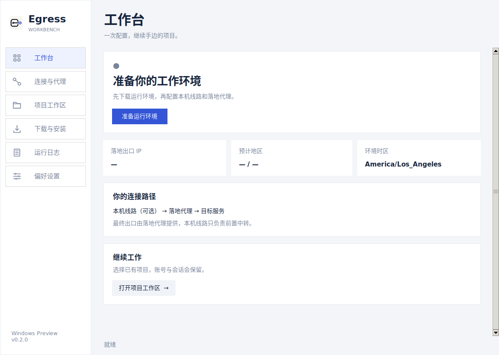
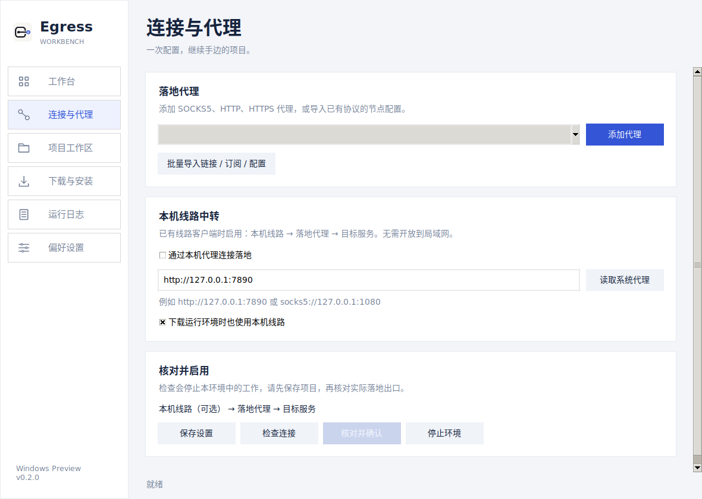

# Windows 0.2.0 交付与验证

日期：2026-11-07。应用代码提交：`5499e33f5c06c978c5af414bc94c048a37c8b0d4`。本记录仅增加文档和界面截图，发布标签包含同一套应用代码。

- [Windows 0.2.0 Release](https://github.com/engeeeee/egress-workbench-app/releases/tag/v0.2.0-windows)
- [最终构建与自动化记录](https://github.com/engeeeee/egress-workbench-app/actions/runs/42406522962)
- [使用说明与本机线路配置](../windows/README.zh-CN.md)

## 下载与界面

推荐下载 Setup.exe，安装到当前用户目录并创建快捷方式；免安装包完整解压后运行根目录的 `EgressWorkbench.exe`。两个版本都不需要另外安装 Python，需要运行中的 Docker Desktop / Linux containers。

| 文件 | 字节数 | SHA-256 |
| --- | ---: | --- |
| Egress-Workbench-Windows-x64-0.2.0-Setup.exe | 15,291,079 | `c2ec5486f3c9dc918c44f0e07c8959897c912bcc80fa5e5611e0152df4a49ce9` |
| Egress-Workbench-Windows-x64-0.2.0-Portable.zip | 21,340,686 | `eb022f48d529dddc67cf615141d570475c3e5e5b374db120b79e4cd4fe194c27` |

已经下载最终 CI Artifact，校验 Artifact 摘要、两个交付文件及其校验文件。解开免安装包后确认 GUI / CLI 都是 PE x64，包含嵌入图标、版本资源、共享 `_internal`、线路转发模块、容器配方及更新后的使用说明。Inno Setup 使用标准 x86 安装引导程序，安装的 GUI / CLI 为 x64。GUI 与 CLI 共用运行库，使免安装包相对 0.1.0 的 32,331,704 字节减少约 34%。

Windows runner 上打包 GUI 的本次初始化到首帧记录为 2,200 ms。计时起点是 GUI 初始化入口，不包含进程加载、首次镜像下载或 Docker Desktop 启动；这不是不同机器之间的性能承诺。Docker 检测在首屏之后后台执行。

以下是实际运行源码界面的初始状态截图，未填入演示出口或用户凭据。截图来自 Linux 图形测试环境；Windows 界面启动另有真实 Windows runner 检查。

## 自动化覆盖

最终构建四个任务全部通过：

| 任务 | 验证内容 |
| --- | --- |
| Windows 自动检查 | Python 3.12 下 39 项检查；所有界面页启动；未保存设置阻止确认 |
| Linux 自动检查 | 同一组 39 项检查，包括代理导入、下载和 TCP 转发 |
| Windows 打包 | GUI / CLI 构建与运行、HTTP / SOCKS 下载依赖、转发模块、图标资源、GUI 首帧；当前用户安装、开始菜单快捷方式、运行已安装 CLI、卸载保留私有数据 |
| 原生 x64 容器 | 工具与浏览器完整流程、双层代理、环境包导出，以及 containerd / classic 两种独立存储中的真实下载与导入 |

代理与下载检查覆盖：

- SOCKS5 / HTTP / HTTPS 导入、用户名密码百分号解码、IPv6 loopback、本机线路范围限制。
- HTTPS 代理和 HTTPS 订阅明确区分；Clash 用户名、密码和 TLS 参数保留；不支持的 TLS 包装拒绝导入。
- 暂停续传、HTTP Range、服务器忽略 Range 时重新下载、完整缓存复用、损坏文件拒绝。
- 四路并发 TCP 转发，每路 1 MiB 双向数据及半关闭处理。

## 真实连接和安装验证

测试使用临时自建服务和临时项目，没有使用用户节点、订阅或账号。公开记录不包含实测出口 IP。

1. 原生 x64 构建 gateway / work / browser，两个外部来源出口 IPv4 一致，工作容器直连公网被阻断。
2. 检查、复核和确认连接；共享 Chromium / noVNC 启动，主机只监听 loopback。
3. 收到真实 VNC 协议数据，错误令牌和外部 Origin 被拒绝；工具可执行，授权网址转交浏览器，共享 localhost OAuth 回调可达。
4. 主机许可失效后网关退出，容器继续无法直连；停止、重新检查和确认后项目文件、工具 home、项目容器可写层与浏览器 home 保留。
5. **本机带认证 HTTP CONNECT 线路 → 带认证 SOCKS5 落地**，完成出口核对和确认。前置代理只允许访问落地的指定端口，确认请求确实经过双层链路。
6. **本机带认证 HTTP CONNECT 线路 → 带认证 HTTP 落地**，完成相同核对。
7. 关闭本机线路代理后，连接检查失败并停止环境，没有直连兜底。
8. 从已验证的镜像 ID 导出不含镜像标签的版本环境包，记录整包 SHA-256、配方、OCI 标识和 classic 配置摘要。
9. 通过应用真实安装入口，从本机 HTTP 测试服务器下载完整包，验证摘要、导入 Docker，再次安装不再访问网络。此服务器仅用于测试，正式包从 GitHub HTTPS 获取。
10. 在 containerd 存储及独立 classic 存储分别执行上述安装；已有镜像标签、已有容器标识与可写层内容保留。不切换用户的 Docker 存储设置。

相同的工具、浏览器和本机线路连接流程也在独立 Linux ARM64 / Docker Engine 29.9.3 环境完成。ARM64 容器采用源码构建；此 Release 的预构建包为 Linux amd64。

复现脚本：[integration_runtime.py](../tests/integration_runtime.py)、[integration_chain.py](../tests/integration_chain.py)、[integration_prebuilt.py](../tests/integration_prebuilt.py)。它们只清理自己的临时资源。两种存储的识别与导入测试使用独立 Docker daemon；没有要求用户切换存储。Docker 的两种存储机制参见 [Docker 官方说明](https://docs.docker.com/desktop/features/containerd/)。

## 验证边界

Windows 程序、安装卸载与原生 Linux 容器分别经过自动验证，尚未在真实 Windows 11 + Docker Desktop 桌面完成整套交互验收；主机目录共享、睡眠唤醒、杀毒软件及各版本 WSL 2 的兼容性仍需实际电脑验收。

实际双层网络测试覆盖 HTTP 前置与 SOCKS5 / HTTP 落地。HTTPS 代理已检查解析、TLS 参数及打包依赖，但未对真实服务商的 HTTPS 落地做联机验收。没有使用真实 Anthropic / OpenAI 账号登录或发起模型请求；工具授权和服务商接受情况仍取决于实际账号与线路。

这是独立实现的预览版，尚未代码签名；Chromium 使用 `--no-sandbox`。账号共享、明文私有配置、升级及其他功能限制见使用说明。不能将自动化通过视作匿名、账号安全或所有代理兼容性的保证。
